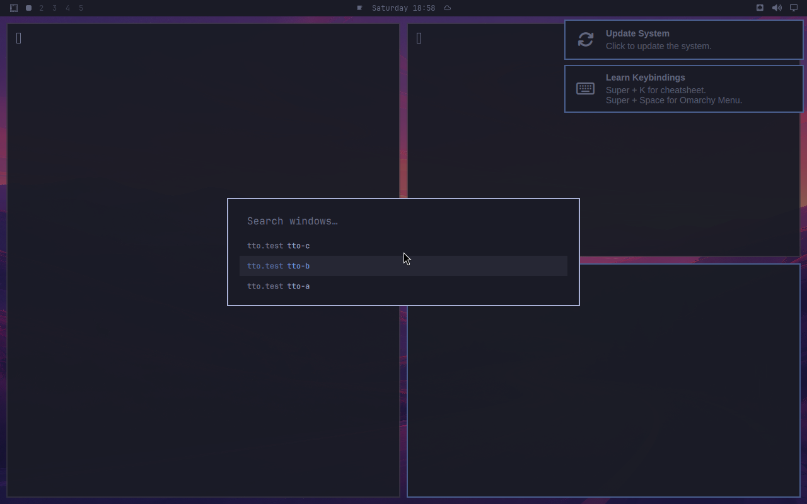
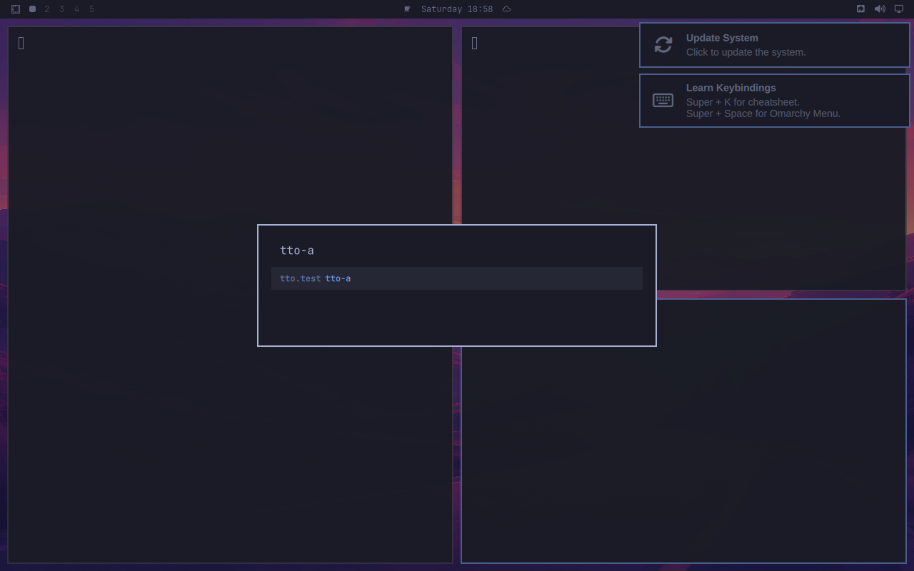

# TapTheTab for Omarchy

**Every window, one tap away.** A keyboard-first, search-first window switcher for the [Omarchy](https://omarchy.org) desktop.

Hold <kbd>Alt</kbd>, tap <kbd>Tab</kbd>, see every window, most recent first. Type to search. Let go to switch.

> **Work in progress — not usable yet.** The current build lists every window most recent first, filters as you type, and switches on Enter or click. It opens only from a command for now (`omarchy-shell shell toggle memoliertorerr.tapthetab '{}'`), not by holding Alt. The build plan and progress live in [`docs/PLAN.md`](docs/PLAN.md).

## Screenshots

Every window, most recently used first:



Type to search; Enter switches:



<sub>Taken automatically by the CI job on a real Omarchy 4.0.6 desktop. The look is still plain; icons, highlights and layout come later.</sub>

This is the Linux sibling of [TapTheTab for macOS](https://github.com/memoliertorerr/tapthetab), rebuilt from scratch as an Omarchy shell plugin.

## Install (once released)

```bash
omarchy plugin add https://github.com/memoliertorerr/tapthetab-omarchy.git --enable
```

## Privacy

No network access, no telemetry, ever.

## License

[MIT](LICENSE)
